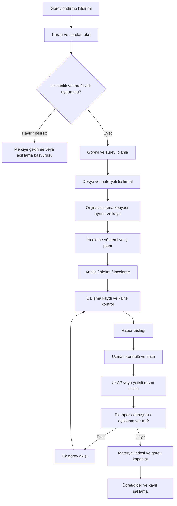

# Görev Yaşam Döngüsü

> **Durum:** TASLAK  
> **Araştırma tarihi:** 12 Kasım 2026  
> **Kapsam notu:** İlk masa başı araştırma sürümü; hukukçu ve gerçek bilirkişi doğrulaması gerektirir.

## Önerilen uçtan uca süreç

## Aşama kartları

| Aşama | Girdi | Çıktı/kayıt | Temel risk | Yazılım desteği |
|---|---|---|---|---|
| Görevlendirme okuma | Karar, dosya, sorular | Görev kaydı, sorular | Kapsamı yanlış anlama | Yapılandırılmış görev özeti, manuel doğrulama |
| Uygunluk | Uzmanlık, tarafsızlık, süre | Kabul/çekinme kararı | Çıkar çatışması veya uzmanlık dışı görev | Kontrol listesi; otomatik karar yok |
| Materyal teslimi | Fiziki/dijital dosya | Teslim tutanağı ve envanter | Eksik, yanlış, hasarlı materyal | Envanter, hash, fotoğraf ekleme (izin varsa) |
| İnceleme | Materyal ve yöntem | Bulgular ve ara kayıt | Orijinalin bozulması | Orijinal/çalışma kopyası disiplini |
| Rapor | Görev soruları, bulgular, yöntem | Taslak ve ekler | Soruların cevapsız kalması | Madde/soru eşlemesi, biçim kontrolü |
| Resmî teslim | İmzalı rapor | UYAP teslim durumu | Yanlış dosya veya teslimin tamamlanmaması | Teslim hazırlık kontrolü; resmî gönderim portalda |
| Kapanış | İade talimatı, gider/ücret bilgisi | İade ve kapanış kaydı | Gereğinden fazla saklama veya erken silme | Kapanış checklist; karar kullanıcı/merci ve hukukçuda |

## Değişken senaryolar

- Hukuk/ceza/idari yargı iş akışları ayrı doğrulanmalıdır.
- Tek bilirkişi/kurul görevlendirmesi ayrı yetki ve rapor modeline sahip olabilir.
- Dijital dosya/fiziki materyal ayrımı ve teslim-tesellüm yöntemi farklıdır.
- Yerinde keşif, laboratuvar/atölye çalışması ve yalnızca dosya üzerinden inceleme farklı lojistik gerektirir.
- Ek raporun ücretlendirilmesi, soruların yeni olması veya mevcut rapordaki eksikliği gidermesi gibi ayrımlara bağlıdır.

Bu tablo işlev modeli için başlangıçtır; gerçek süreç gözlemi olmadan süre ve otomasyon seviyesi atanmamalıdır.

## Kaynaklar

- [6754 sayılı Bilirkişilik Kanunu — Adalet Bakanlığı Mevzuat ve İçtihat Programı](https://mevzuat.adalet.gov.tr/mevzuat/104136)
- [6100 sayılı Hukuk Muhakemeleri Kanunu — Adalet Bakanlığı Mevzuat ve İçtihat Programı](https://mevzuat.adalet.gov.tr/mevzuat/103103)
- [5271 sayılı Ceza Muhakemesi Kanunu — resmî PDF](https://aile.gov.tr/uploads/chgm/uploads/pages/kanunlar/5271-sayili-ceza-muhakemesi-kanunu.pdf)
- [2026 Yılı Bilirkişilik Asgari Ücret Tarifesi — 26.12.2025 Resmî Gazete](https://www.resmigazete.gov.tr/eskiler/2025/12/20251226-4.htm)
- [UYAP Bilirkişi Portal](https://bilirkisi.uyap.gov.tr/)
