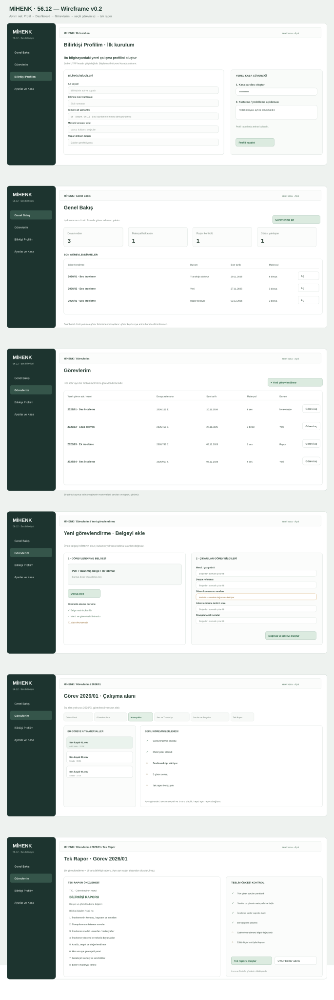

# 56.12 — Kullanıcı Akışı ve Ekran Wireframe'i v0.2

> v0.1 taslağının yerine geçer. 15.11.2026. Düşük ayrıntılı ürün taslağıdır; uygulama kodu değildir.

## 1. Kavramlar ve veri ilişkisi

- **Bilirkişi profili:** Kullanıcının sabit meslekî bilgileri. Bir kez tanımlanır.
- **Genel Bakış / Dashboard:** İş durumunun özeti. Görev adımlarının listesi değildir.
- **Görevlerim:** Birbirinden ayrı görevlendirmelerin listesi. Her satır ayrı bir inceleme işidir.
- **Görevlendirme:** Mahkeme/merci tarafından verilen tek inceleme işi.
- **Materyaller:** Aynı göreve teslim edilen bir veya daha fazla ses kaydı ve diğer belge.
- **Görev soruları:** Aynı görevlendirmede cevaplanacak bir veya daha fazla soru.
- **Tek rapor:** O görevlendirmedeki materyal, yöntem, bulgu, soru-yanıt ve ekleri içeren tek ana bilirkişi raporu.

~~~text
BİLİRKİŞİ PROFİLİ (bir kez)
  ├─ GÖREVLENDİRME A (tek iş)
  │    ├─ Görevlendirme belgesi
  │    ├─ Materyal 1, 2, 3 ... (çoklu ses/belge)
  │    ├─ Soru 1, 2, 3 ... (çoklu soru)
  │    ├─ Bulgular ve dayanaklar
  │    └─ TEK RAPOR
  └─ GÖREVLENDİRME B (ayrı iş)
       ├─ Kendi belgesi ve materyalleri
       ├─ Kendi soruları ve bulguları
       └─ KENDİ TEK RAPORU
~~~

Bir kullanıcının birçok görevlendirmesi olabilir. Bir görevlendirmenin birçok materyali ve sorusu olabilir. Her görevlendirmenin ayrı çalışma alanı ve tek ana raporu vardır. Görevler arası veri karışması yasaktır.

## 2. Giriş ve bilirkişi profili

MİHENK, UYAP hesabı değildir. İlk kullanımda kullanıcı yerel şifreli kasasını kurar ve bilirkişi profilini tanımlar. Sonraki açılışlarda yalnızca yerel kasanın kilidini açar; profili tekrar oluşturmaz.

İlk sürüm varsayımı: Bir yerel kasa bir bilirkişi profiline bağlıdır. Aynı Windows hesabında birden fazla bilirkişinin ayrı profilleri, tasarlanıp test edilmeden destekleniyor gibi gösterilmez.

Profil alanları: ad soyad, bilirkişi sicil numarası, temel/alt uzmanlık alanı (ilk ürün 56.12), varsa meslekî unvan ve rapor örneğinin gerektirdiği ek bilgiler. UYAP parolası veya e-imza PIN'i istenmez. Profil şifreli yerel alanda saklanır; eski raporların üretim anındaki profil görüntüsü korunur.

## 3. Sol menü ile görev içi adımlar farklıdır

Sol menü yalnızca uygulama genelindeki dört alanı gösterir:

1. **Genel Bakış** — Dashboard; yalnızca özet ve yaklaşan işler.
2. **Görevlerim** — bütün ayrı görevlendirmelerin listesi; yeni görev buradan başlatılır.
3. **Bilirkişi Profilim** — sabit meslekî bilgiler.
4. **Ayarlar ve Kasa** — güvenlik, yedekleme ve güncelleme.

Bir görev açıldığında sağ içerik alanında yalnızca o göreve ait sekmeler görünür:

**Görev Özeti · Görevlendirme · Materyaller · Ses ve Transkript · Sorular ve Bulgular · Tek Rapor**

Bunlar sol menü değildir. Başka göreve geçildiğinde bu sekmeler o görevin kendi verisini gösterir.

## 4. Ekran akışı

### E0 — İlk kurulum / Bilirkişi profilim
Yerel kasa oluşturulur ve profil bir kez doldurulur. Sonraki açılışlarda yerel kasa açılır.

### E1 — Genel Bakış (Dashboard)
Yalnızca devam eden görevlendirme sayısı, rapor kontrolü bekleyenler, doğrulanmış yaklaşan tarihler ve son açılan görevler görünür. Ana eylem: **Görevlerime git** veya **Yeni görevlendirme**. Burada görev adımları veya materyal düzenleme bulunmaz.

### E2 — Görevlerim
Her kart/satır ayrı bir görevlendirmedir. Merci, kısa görev etiketi, doğrulanmış son tarih, materyal adedi, durum ve **Görevi aç** gösterilir. **Yeni görevlendirme** belge ekleme akışını başlatır. Boş durumda örnek dosya veya sahte sayaç yoktur.

### E3 — Görevlendirme belgesini ekle ve otomatik oku
Kullanıcı görevlendirme yazısını/kararını ve ek talimatları ekler. MİHENK belgeyi otomatik okur; merci, dosya referansı, tarih/süre, görev konusu/kapsamı, sorular ve materyal talimatlarını çıkarır. Her alan belge sayfasına/metnine bağlanır.

**Kullanıcının görevi baştan kendisinin okuyup formu doldurması beklenmez.** Önce uygulama okur ve alanları doldurur; kullanıcı yalnızca belirsiz, çelişkili veya okunamayan alanları doğrular. Okuma hatası varsa sistem değer uydurmaz; yalnız o alanı istisnaya çıkarır.

### E4 — Seçili görevin çalışma alanı
Başlıkta görev kimliği, merci, son tarih ve durum görünür. Görev sekmeleri:
- **Görev Özeti:** belgeden çıkarılan ve doğrulanan bilgiler.
- **Görevlendirme:** kaynak belge, kapsam, süre ve özgün sorular.
- **Materyaller:** bir veya daha fazla ses/dosya; beklenen, teslim alınan, aktarılan, incelenen ve iade edilen durumları.
- **Ses ve Transkript:** bütün ses kuyruğu; seçili sesin oynatıcısı, dalga biçimi, yerel ASR ve zaman bağlantılı metin.
- **Sorular ve Bulgular:** her soruya uzman yanıtı ve bu göreve ait kaynak segment/ek.
- **Tek Rapor:** o görevin tek ana raporu.

### E5 — Tek rapor
Kullanıcı ayrı ayrı DOCX, ODT, JSON ve başka raporlar üretmek zorunda kalmaz. **Her görevlendirme için tek ana rapor** hazırlanır. Raporda merci/dosya bilgileri, bilirkişi profili, inceleme konusu-kapsamı-sınırları, görev soruları, materyal envanteri, yöntem/araç/model/sürüm, uzman tarafından doğrulanmış bulgular, her soruya gerekçeli yanıt, sınırlılıklar ve numaralı ekler bulunur. Büyük ses dosyaları rapora gömülmez; kaynak envanteri ve zaman kodlarıyla gösterilir.

## 5. Rapor örnekleri doğru nasıl kullanılmalı?

Bilirkişilik Daire Başkanlığının sayfasında hukuk/idare-vergi, ceza mahkemesi, Cumhuriyet başsavcılığı ve icra müdürlüğü için ayrı örnek rapor şablonları yayımlanır. Buna karşılık Mayıs 2025 tarihli Bilirkişilik Temel Eğitimi Kaynak Kitabı, raporlar için özel ve değişmez bir şablon bulunmadığını; örneklerin ihtiyatla kullanılmasını ve kopyala-yapıştır yapılmamasını belirtir.

Bu nedenle MİHENK bu örnekleri zorunlu ve değişmez form gibi sunmaz. Görevlendirme belgesinden merci/yargı türünü çıkarır, ilgili örnek iskeleti önerir ve görev talimatına göre uyarlanmasını sağlar. Belirsiz alanlar doğrulanır; eski rapordan içerik kopyalanmaz.

Örnek ortak gövde: incelemenin konusu/kapsamı/sınırları; cevaplanacak sorular; incelenmesi istenen maddi unsurlar; yöntem ve bilimsel/teknik dayanaklar; analiz/tespit/değerlendirme; gerekçeli sonuç; ekler. Merciye göre kapak ve kimlik alanları değişebilir.

## 6. Tek belge ve UYAP Editör

Hedef, kullanıcıya tek düzenlenebilir ana rapor vermektir. UYAP Editör resmî yardımı, Editörün varsayılan kayıt biçiminin UDF olduğunu ve başka biçimlere farklı kaydetme imkânı bulunduğunu belirtir. Ancak bu bilgi MİHENK'in ürettiği belirli bir dosyanın Editör'de açıldığını veya Bilirkişi Portalı'nın ilgili evrak türünde kabul ettiğini tek başına kanıtlamaz.

Çıktı biçimi gerçek Windows UYAP Editör'de açma, Türkçe karakter/sayfa/tablo/ek kontrolü, UDF kaydetme ve yeniden açma testlerinden sonra kesinleştirilir. Portalın ilgili evrak türü için biçim kabulü ayrıca doğrulanır. Test tamamlanmadan MİHENK “UYAP'a hazır” iddiasında bulunmaz. İmza ve resmî gönderim bilirkişide kalır.

## 7. Tasarım kabul maddeleri

- [ ] Dashboard yalnızca özet; görev adımları orada yok.
- [ ] Görevlerim listesinde her görevlendirme ayrı.
- [ ] Bir görevde birden fazla materyal ve soru bulunabiliyor.
- [ ] Görevlendirme belgesini önce uygulama okuyor; kullanıcı yalnız belirsiz alanları doğruluyor.
- [ ] Sol menü global alanlardan; görev sekmeleri seçili görevin içinden oluşuyor.
- [ ] Bilirkişi profili bir kez tanımlanıp her rapora aktarılıyor.
- [ ] Her görevlendirme için tek ana rapor üretiliyor.
- [ ] Örnek rapor iskeletleri zorunlu sabit form gibi sunulmuyor.
- [ ] UYAP/Editör biçimi gerçek masaüstü testi geçmeden vaat edilmiyor.

## 8. Kaynaklar

- [Adalet Bakanlığı — Bilirkişi Rapor Şablonları](https://bilirkisilik.adalet.gov.tr/Home/SayfaDetay/bilirkisi-rapor-sablonlari14032022105509)
- [Bilirkişilik Temel Eğitimi Kaynak Kitabı, Mayıs 2025](https://bilirkisilik.adalet.gov.tr/Resimler/SayfaDokuman/15052025204011Bilirkis%CC%A7ilik%20Temel%20E%C4%9Fitimi%20Kaynak%20Kitab%C4%B1.pdf)
- [Bilirkişiler İçin Kontrol Listesi](https://bilirkisilik.adalet.gov.tr/Resimler/SayfaDokuman/14032022110908Bilirki%C5%9Filer%20i%C3%A7in%20Kontrol%20Listesi.pdf)
- [UYAP Doküman Editörü resmî yardım](https://uyap.gov.tr/Uyap-Editor-Yardim)
- [56.12 resmî alt uzmanlık tanımı](https://bilirkisilik.adalet.gov.tr/Resimler/SayfaDokuman/20260122151908585Bilirki%C5%9Filik%20Temel%20ve%20Alt%20Uzmanl%C4%B1k%20Alanlar%C4%B1%20ile%20Bilirki%C5%9Filerde%20Aranan%20Nitelikler.pdf)
