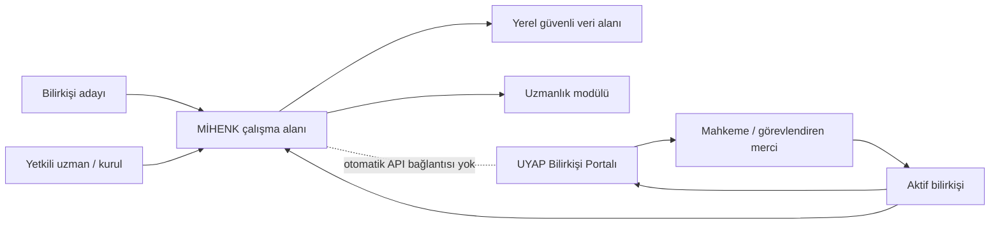

# Sistem Bağlam Diyagramı

> **Durum:** TASLAK  
> **Araştırma tarihi:** 12 Kasım 2026  
> **Kapsam notu:** İlk masa başı araştırma sürümü; hukukçu ve gerçek bilirkişi doğrulaması gerektirir.

## Sınırlar

- MİHENK sadece kullanıcının yetkili şekilde oluşturduğu çalışma kayıtlarını yönetir.
- UYAP resmî kayıt ve teslim noktasıdır.
- MİHENK, mahkeme/merci veya diğer taraflarla bağımsız bir resmî kanal oluşturmaz.
- Bulut, senkronizasyon, ekip paylaşımı ve dış veri aktarımı ayrıca onaylanmadıkça kapalıdır.

## Kaynaklar

- [UYAP Bilirkişi Portal](https://bilirkisi.uyap.gov.tr/)
- [6754 sayılı Bilirkişilik Kanunu — Adalet Bakanlığı Mevzuat ve İçtihat Programı](https://mevzuat.adalet.gov.tr/mevzuat/104136)
